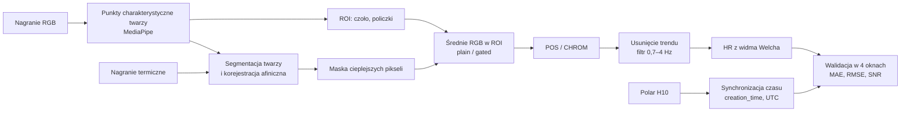

# rppg-thermal-UAV

Bezdotykowy pomiar częstości akcji serca (HR) z pokładu drona metodą zdalnej fotopletyzmografii (rPPG), z wykorzystaniem kamery widzialnej i termowizyjnej DJI Matrice 4T.

Repozytorium zawiera kod do pracy magisterskiej *„Bezdotykowy system pomiaru pulsu z wykorzystaniem bezzałogowego statku powietrznego (BSP) i kamery termowizyjnej”* (AGH, Wydział Elektrotechniki, Automatyki, Informatyki i Inżynierii Biomedycznej, 2026).

## Opis

System przetwarza w pełni automatycznie jednocześnie zarejestrowane nagrania RGB i termowizyjne twarzy, bez ręcznego wskazywania obszarów, punktów kontrolnych ani przesunięć czasowych. Każde nagranie jest przetwarzane w dwóch wariantach:

- **plain**: średnia kanałów RGB z całego obszaru zainteresowania (ROI);
- **gated**: średnia tylko z pikseli ROI cieplejszych od średniej w obszarze, wyznaczonych na podstawie obrazu termicznego po korejestracji z obrazem RGB.

Porównanie obu wariantów sprawdza, czy obraz termiczny poprawia estymację tętna. Referencją jest pas piersiowy Polar H10.

## Schemat przetwarzania



Najważniejsze elementy:

| Etap | Metoda |
|---|---|
| Detekcja twarzy | MediaPipe FaceLandmarker (468 punktów), wycinki 1000/1300/700/1600 px z obrazu 4K |
| ROI | Prostokąty czoła i obu policzków z punktów charakterystycznych |
| Korejestracja termika → RGB | Segmentacja twarzy (Otsu, morfologia, cięcie na wysokości szyi), dopasowanie konturów (36 punktów), przekształcenie afiniczne z kontrolą skali i anizotropii |
| Maska termiczna | Próg μ + 0,5σ jasności termicznej w ROI; mniej niż 10% pikseli → pełny ROI |
| Ekstrakcja sygnału | POS, CHROM (okno 1,6 s, overlap-add); GREEN i ICA dostępne porównawczo |
| Przetwarzanie | Usunięcie trendu (smoothness priors, λ = 300), Butterworth 3. rzędu 0,7–4 Hz, filtracja zerofazowa |
| Estymacja HR | Maksimum widma Welcha (segmenty 10 s, 50% nakładania, okno Hanninga, nfft ≥ 2048) |
| Walidacja | 4 równe okna na nagranie, MAE, RMSE, udział błędów oktawowych, SNR, ΔSNR (gated − plain) |

## Wyniki

33 nagrania, 7 badanych, 5 scenariuszy, wariant plain (szczegóły w rozdziale 6 pracy):

| Scenariusz | Opis | Mediana błędu nagrania [BPM] | Estymaty z błędem ≤ 10 BPM |
|---|---|---|---|
| s1 | Dron na statywie, badany nieruchomo | 3,4 | 21 / 28 |
| s2 | Dron na statywie, badany w ruchu | 31,1 | 10 / 28 |
| s3 | Dron w zawisie, badany nieruchomo | 1,1 | 22 / 28 |
| s4 | Dron w zawisie, badany w ruchu | 16,1 | 11 / 28 |
| s5 | Lot dynamiczny (badany idzie, dron się cofa) | 31,6 | 3 / 20 |

- Przy nieruchomym badanym zawis drona nie pogorszył dokładności względem statywu.
- Wiarygodną korejestrację uzyskano w 13 z 33 nagrań.
- Maskowanie termiczne nie zwiększyło SNR (mediana ΔSNR −0,23 dB w 52 porównaniach) i nie poprawiło dokładności. Główną przyczyną jest nieradiometryczny, 8-bitowy zapis obrazu termicznego z automatyczną regulacją wzmocnienia.

## Wymagania

- Python 3.11, zarządzany przez [uv](https://docs.astral.sh/uv/)
- FFmpeg (`ffprobe` w `PATH`), do odczytu znacznika czasu `creation_time` z plików MP4
- Model `models/face_landmarker.task`, dołączony do repozytorium

## Instalacja

```bash
git clone https://github.com/Wiktor6220/rppg-thermal-UAV.git
cd rppg-thermal-UAV
uv sync
```

## Dane wejściowe

Zbiór danych nie jest publiczny, bo zawiera nagrania twarzy i dane fizjologiczne uczestników badania. Program oczekuje struktury:

```text
data/
└── <badany>/            np. subject01
    └── <scenariusz>/    np. s1_rest_rest
        ├── *_V.MP4      lub *_RGB.MP4    nagranie widzialne
        ├── *_T.MP4                       nagranie termiczne
        └── *_HR.csv     lub dataHR_*.csv eksport z Polar H10
```

Nazwy scenariuszy: `s1_rest_rest`, `s2_person_move`, `s3_drone_move`, `s4_both_move`, `s5_approach`. Plików referencyjnych nie trzeba przycinać: synchronizacja z nagraniem odbywa się automatycznie na podstawie znaczników czasu (`creation_time` pliku MP4 i godziny startu w nagłówku pliku Polar, strefa Europe/Warsaw).

## Uruchomienie

```bash
uv run run.py                          # wszyscy badani z data/
uv run run.py --subject subject04      # jeden badany
uv run run.py --recalibrate            # ponowna kalibracja korejestracji każdej sceny
uv run run.py --figures-only           # tylko korejestracja i jej figury, bez HR i metryk
uv run run.py --data data --out results/pipeline   # wartości domyślne
```

## Wyniki przetwarzania

```text
results/pipeline/
├── all_subjects.csv          wszystkie wiersze ze wszystkich nagrań
├── summary.md                tabela zbiorcza
└── <badany>/<scenariusz>/
    ├── metrics.csv / .md     HR całego nagrania i 4 okien, MAE, RMSE, SNR (plain/gated)
    ├── reg_calib.json        kalibracja korejestracji
    ├── reg_quality.json      jakość korejestracji, status trustworthy / NO-GO
    ├── fig_rgb_roi.png       ROI na klatce RGB
    ├── fig_thermal_seg.png   segmentacja twarzy w termice i maska
    ├── fig_overlay_reg.png   termika nałożona na RGB po korejestracji
    ├── fig_hr_windows.png    HR w 4 oknach na tle referencji
    └── fig_spectrum.png      widmo Welcha
```

`summary.md` i `all_subjects.csv` są składane ze wszystkich nagrań w katalogu wyjściowym, więc przebieg z `--subject` odświeża tylko wybranego badanego.

## Struktura kodu

| Moduł | Zawartość |
|---|---|
| `src/config.py` | Wszystkie stałe: pasmo, progi, parametry korejestracji, ścieżki |
| `src/io_layer.py` | Odczyt wideo, parowanie klatek RGB i termicznych, wczytanie i synchronizacja zapisu Polar |
| `src/roi.py` | Detekcja punktów charakterystycznych twarzy, ROI |
| `src/registration.py` | Segmentacja twarzy w termice, korejestracja, ocena jakości |
| `src/extract.py` | Średnie RGB w ROI, maska cieplejszych pikseli |
| `src/methods.py` | POS, CHROM, GREEN, ICA |
| `src/estimate.py` | Usunięcie trendu, filtracja, HR z widma Welcha, SNR |
| `src/validate.py` | Okna walidacyjne, MAE, RMSE, błędy oktawowe |
| `src/pipeline.py` | Sterowanie przetwarzaniem wszystkich nagrań |
| `src/figures.py`, `src/report.py` | Figury diagnostyczne, tabele i podsumowanie |

`run.py` to cienka nakładka wiersza poleceń na `src.pipeline.run_pipeline`.

## Testy

```bash
uv run pytest
```

52 funkcje testowe (74 przypadki po uwzględnieniu parametryzacji) działają wyłącznie na danych syntetycznych, np. sinusoidzie o znanej częstotliwości, syntetycznych klatkach RGB i termicznych czy eliptycznych maskach twarzy, więc nie wymagają katalogu `data/`.

## Ograniczenia

- Obraz termiczny był zapisywany jako 8-bitowy podgląd wideo z automatyczną regulacją wzmocnienia, bez wartości temperatury. Skóra twarzy jest w nim w dużej części przesycona.
- Korejestracja opiera się na obrysie twarzy i zawodzi przy szybkiej zmianie odległości (scenariusz s5).
- Badanie objęło 7 osób i jedną sesję pomiarową.

## Autor

Wiktor Raczek, AGH Akademia Górniczo-Hutnicza w Krakowie

Model `face_landmarker.task` pochodzi z projektu [MediaPipe](https://github.com/google-ai-edge/mediapipe) (Google, licencja Apache 2.0).
